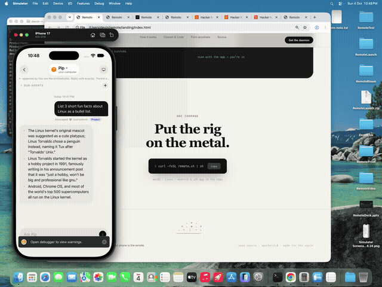
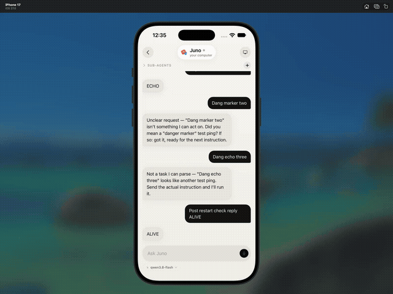
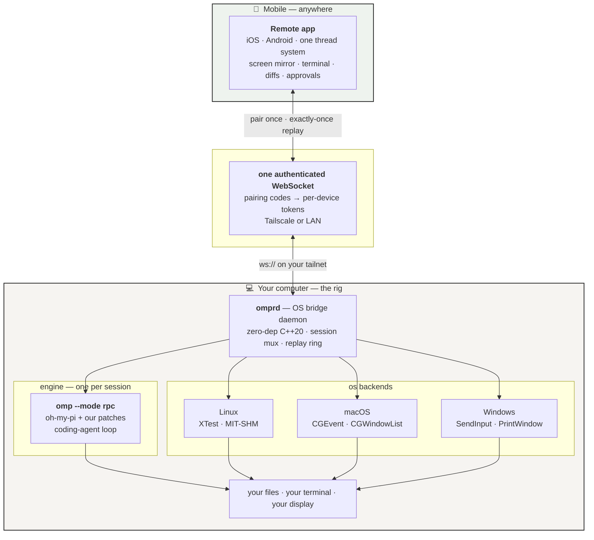
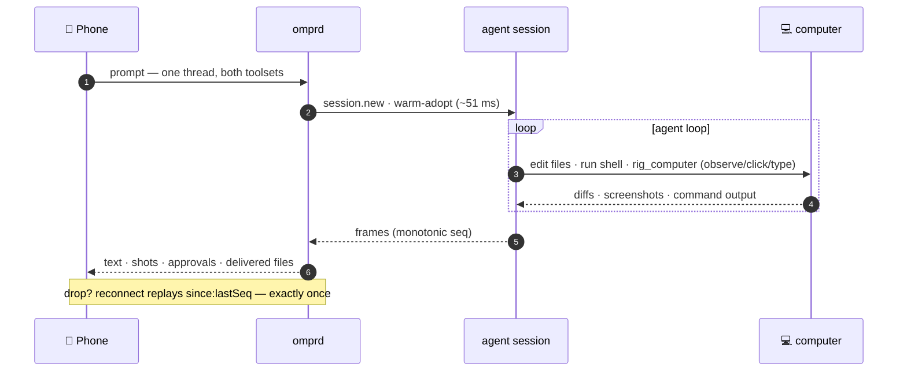
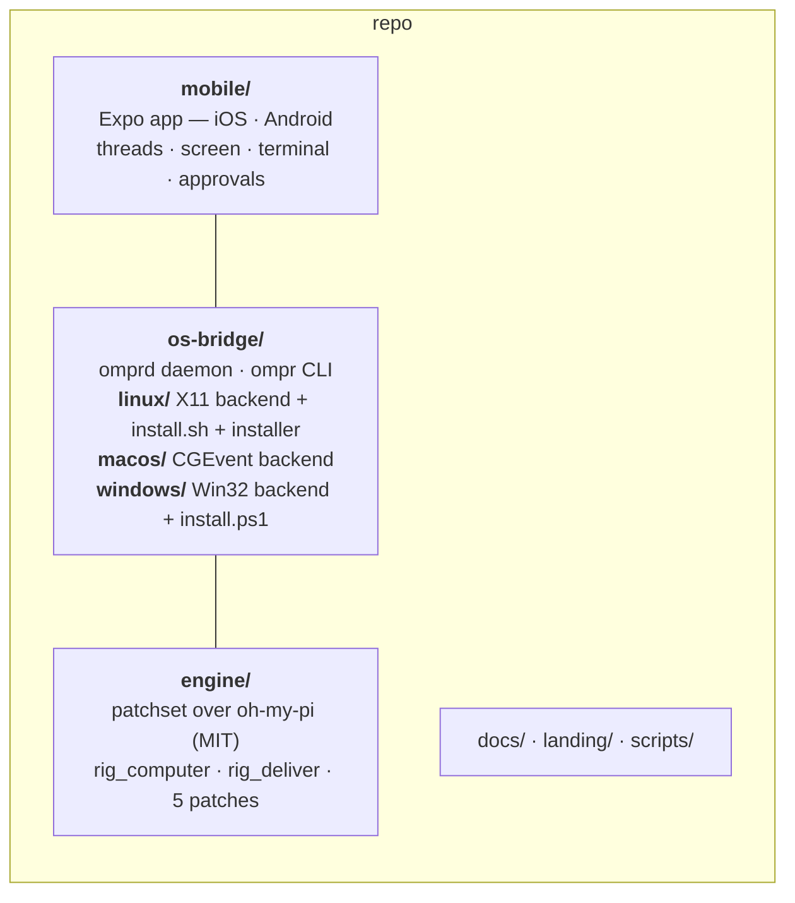

<div align="center">

# Remote

### Your laptop is the computer. Your phone is the remote.

[](LICENSE)
[](#components)
[](#components)
[](#components)

**Remote turns the machine you already own into a coding rig you drive from
your pocket. One thread does it all — the agent edits code, runs your
terminal, and clicks your real screen. No cloud between phone and laptop;
your credentials never leave the rig. Wi-Fi or Tailscale — even lid-closed.**

</div>

---

<div align="center">

### See it

[](https://github.com/GC-WORK11/remote/releases/download/v0.1/demo-inbox.mp4)

*The inbox — every bot can code, browse the web, or drive your literal desktop.*
*([full video](https://github.com/GC-WORK11/remote/releases/download/v0.1/demo-inbox.mp4))*

[](https://github.com/GC-WORK11/remote/releases/download/v0.1/demo-thread.mp4)

*A thread — real agent turns, sub-agents, model picker, computer context.*
*([full video](https://github.com/GC-WORK11/remote/releases/download/v0.1/demo-thread.mp4))*

</div>

---

## How it fits together



## A turn, end to end



## Why not Grok Bot / Cursor mobile / Devin mobile?

We love those products — Remote borrows their best ideas. The structural
difference is **where the session runs**:

| | Session lives on | Screen | Credentials | Transport |
|---|---|---|---|---|
| **Remote** | **your computer** | **live mirror + takeover** | **rig's vault — phone never sees keys** | **your LAN/tailnet** |
| Grok Bot | xAI's cloud | — | their cloud | their servers |
| Cursor mobile | your machine, *their* agent loop | — | their cloud | their servers |
| Devin mobile | Cognition's cloud VM | — | their cloud | their servers |
| OpenClaw | your machine | agent-only `computer.act` | gateway config | your gateway |

Your phone isn't a pager for somebody else's session — it's the remote for
*your* machine: your uncommitted diffs, your local daemons, your logged-in
subscriptions, your real display to watch and grab.

## Components



| Path | What it is |
|---|---|
| `os-bridge/` | **The daemon** — `omprd`, a single-TU C++20 WebSocket bridge: pairing/auth, session mux, exactly-once replay, computer-use backends per OS, `ompr` CLI, tests, installer. `linux/` `macos/` `windows/` hold the platform layer each. |
| `mobile/` | **The app** — Expo / React Native. One thread system: computer-use + coding routed by the prompt, not a mode toggle. |
| `engine/` | **Patches over [oh-my-pi](https://github.com/can1357/oh-my-pi)** (MIT) — `rig_computer`, `rig_deliver`, cwd preservation, bounded model discovery. Upstream is vendored under `engine/omp` (gitignored); the patches are the artifact. |
| `docs/` | `AUTH.md` · `BENCHMARKS.md` · `COMPAT.md` · `ROADMAP.md` |
| `os-bridge/protocol.md` | The wire protocol — read before writing a client. |
| `landing/` | Project website (static). |

## What it does

- **Real computer use** — screenshot, click, type (real key events),
  scroll, drag, window control, app launch, screen recording. Measured:
  click ~11 ms, 1080p jpeg ~27–52 ms (`docs/BENCHMARKS.md`).
- **One conversation, both toolsets** — a thread can edit code, run
  builds, drive the desktop, and hand back a diff or a delivered file.
- **Lid closed, rig awake** — keep-awake assertions + per-OS lid handling
  (systemd-inhibit / pmset / powercfg). Laptop shut, work continues —
  where hardware allows.
- **Live screen + takeover** — stream the real display, tap to drive,
  hand control back.
- **Phone as approval gate** — risky tool calls pause for Approve/Deny.
- **Host-side auth** — provider OAuth/keys stay in the engine's vault on
  the rig; the phone sees state, never secrets.
- **Exactly-once replay** — monotonic `seq` per frame; a dropped tunnel
  resumes mid-turn without duplicates.

## Setup

Requirements — a computer you want to drive (Linux, macOS, or Windows), a
C++20 toolchain on it, [Bun](https://bun.sh) for the engine, and a phone on
the same LAN or Tailscale tailnet.

**1 · Install the bridge on the computer**

```sh
git clone https://github.com/GC-WORK11/remote.git && cd remote
sh os-bridge/linux/install.sh        # Linux: build + user service + pairing QR
# macOS:  cd os-bridge && make       # grants Input/Screen permissions on first run
# Windows: os-bridge/windows/install.ps1
```

The installer drops a `omprd` user service, keeps the machine awake with the
lid closed (where the OS allows), and prints a QR + `remote://ip:8790#code`.
Manual alternative: `cd os-bridge && make && ./daemon/omprd --qr`.

**2 · Install the engine**

```sh
npm i -g @oh-my-pi/pi-coding-agent   # vanilla upstream agent
```

or apply `engine/patches/apply.sh` over an upstream checkout for the full
`rig_computer` toolset (screenshots, click, type, scroll, launch, windows):

```sh
git clone https://github.com/can1357/oh-my-pi engine/omp
sh engine/patches/apply.sh
```

Sign in once on the rig — `omp auth login` — so provider credentials live
on the computer, never on the phone.

**3 · Get the app on your phone**

```sh
cd mobile && npm i && npx expo start     # dev build / Expo Go
# release APK: cd mobile && npx expo run:android --variant release
```

**4 · Pair**

Open the app → paste the `remote://` link (or scan the QR on the computer's
terminal). Enter the 6-digit code → done. The inbox shows up; open a thread,
type what you want, and it happens on your computer — code, terminal,
browser, or literal mouse and keys.

## Inspiration

Remote exists because these products proved the shape — we took the best
idea from each and rebuilt the stack around *your* hardware:

- **Grok Bot** — the inbox-of-threads model and routine-style triggers.
- **Cursor mobile** — code-first thread UX, workspace ergonomics.
- **Devin** — remote agent UX done right: progress you can actually read.
- **Muse / OpenAI Dots** — ambient, quiet, premium mobile surfaces.
- **Peekaboo / CUA** — proof that native input injection is the way.

## Security model

One authenticated WebSocket. One-time 6-digit pairing codes (10-min TTL)
mint per-device bearer tokens, stored SHA-256-hashed on the rig.
Unauthenticated sockets can only pair. Prefer your Tailscale IP —
WireGuard is the transport security. Details: `docs/AUTH.md`; reporting:
`SECURITY.md`. **Unaudited** — treat accordingly.

## Verify

```sh
cd os-bridge && python3 test/client.py             # pair → spawn → real turn
python3 test/computer-correctness.py               # 49/49 real-display checks
```

## License

MIT — see `LICENSE`. Engine patches apply on oh-my-pi (MIT, © Mario
Zechner / Can Bölük / Stencil Labs). Vendored deps: `json.hpp` (nlohmann,
MIT), `stb_image_write.h` (public domain), `qr.hpp`, `crypto.hpp`,
`rigfs.hpp`.
